<!--made with  <3 by Luiz Eduardo -->

  

  

 

<!-- 🇧🇷:  APRESENTAÇÃO -->

  

 

###  Sociais: 

  
  
  

<!-- 🇧🇷: TECNOLOGIAS (estilo skillicons) -->

###  Tecnologias Frontend

  

  &nbsp;&nbsp;

 

###  Backend & APIs

  

 

###  Banco de Dados & Cloud

  

 

###  Ferramentas & Plataformas

  

  &nbsp;&nbsp;&nbsp;&nbsp;&nbsp;&nbsp;

  &nbsp;&nbsp; &nbsp;&nbsp

 

<!-- 🇧🇷: Frase para espalhar o evangelho para o mundo :) -->

  

 

<!-- 🇧🇷: Contribuições animadas  -->

  <h3><code>luizdudu@github ~ $ ./contributions.sh</code></h3>
  

  

